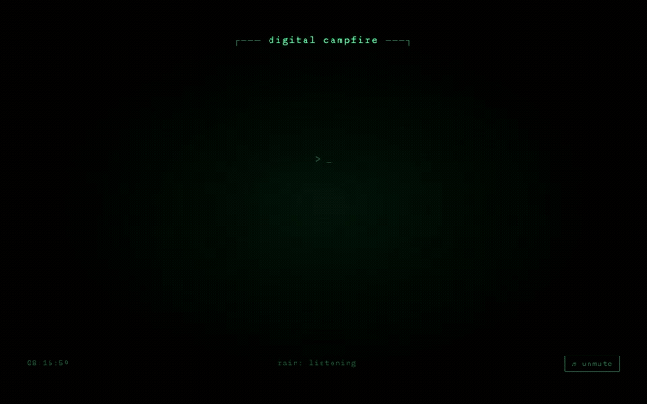

# digital-campfire
### Need to unwind? 😌 

* CRT (Cathode Ray Tube) vibes
* rain sounds
* terminal glow
* 30 rotating quotes/poetry
* tiny safe corner for your brain

### Three files in digital-campfire/:

- index.html — CRT monitor shell with scanlines, flicker overlay, and phosphor glow
- style.css — green-on-black terminal aesthetic, radial glow pulse, scanline animation, cursor blink
- app.js — shuffled text fragments with typewriter effect, procedural rain via Web Audio API noise +
bandpass filters, distant thunder on random intervals

## Usage
Open index.html in a browser. Click **♫ unmute** in the bottom-right to start the rain. Text cycles every 18
seconds with a slow typewriter fade. Thunder rolls in every 15–60 seconds, barely there — just enough to
notice.

---

No dependencies, no build step, no external audio files. Everything is self-contained.

 
